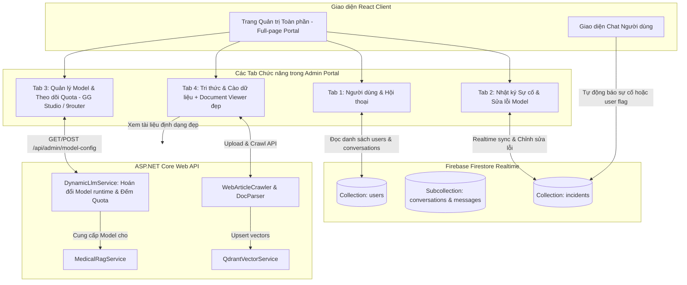

# Kế hoạch Nâng cấp Trang Quản trị Toàn diện (Admin Portal) cho Chatbot_v1

Kế hoạch này chi tiết hóa kiến trúc, giao diện và API để nâng cấp cổng quản trị hiện tại từ modal đơn lẻ thành một Trang Quản trị Toàn màn hình (Full-page Admin Portal). Hệ thống tích hợp 4 module: Giám sát Người dùng & Hội thoại, Nhật ký Sự cố & Đánh giá Model, Quản trị Model & Theo dõi Quota, và Quản trị Tri thức & Cào dữ liệu (kèm Bộ đọc Văn bản đẹp Document Viewer).

---

## 1. Sơ đồ Kiến trúc & Luồng Hoạt động (Mermaid)



---

## 2. Danh sách Các Tệp Tạo Mới & Chỉnh Sửa

- [Labs/Components/Chatbot_v1/src/Chatbot.Fe/src/components/AdminPortal.tsx](Labs/Components/Chatbot_v1/src/Chatbot.Fe/src/components/AdminPortal.tsx) (Tạo mới - Giao diện toàn trang Admin với 4 Tabs, Document Viewer đẹp mắt và Sidebar quản trị riêng)
- [Labs/Components/Chatbot_v1/src/Chatbot.Be/Rag/Services/DynamicLlmService.cs](Labs/Components/Chatbot_v1/src/Chatbot.Be/Rag/Services/DynamicLlmService.cs) (Tạo mới - Service quản lý chuyển đổi runtime LLM model giữa Google Studio và Bên thứ 3/9router + thống kê quota token)
- [Labs/Components/Chatbot_v1/src/Chatbot.Fe/src/services/firebase.ts](Labs/Components/Chatbot_v1/src/Chatbot.Fe/src/services/firebase.ts) (Chỉnh sửa - Bổ sung hàm sync user profile, lấy danh sách tất cả users, lấy conversations/messages của user, CRUD incident trên Firestore)
- [Labs/Components/Chatbot_v1/src/Chatbot.Fe/src/services/api.ts](Labs/Components/Chatbot_v1/src/Chatbot.Fe/src/services/api.ts) (Chỉnh sửa - Bổ sung API client cho model-config runtime, quota metrics, doc detail)
- [Labs/Components/Chatbot_v1/src/Chatbot.Fe/src/App.tsx](Labs/Components/Chatbot_v1/src/Chatbot.Fe/src/App.tsx) (Chỉnh sửa - Bổ sung cờ điều hướng full-page `view: 'chat' | 'admin'`, đồng bộ user profile khi đăng nhập)
- [Labs/Components/Chatbot_v1/src/Chatbot.Fe/src/components/Sidebar.tsx](Labs/Components/Chatbot_v1/src/Chatbot.Fe/src/components/Sidebar.tsx) (Chỉnh sửa - Thêm nút điều hướng rõ ràng vào Cổng Quản trị dành cho người dùng)
- [Labs/Components/Chatbot_v1/src/Chatbot.Fe/src/components/MessageItem.tsx](Labs/Components/Chatbot_v1/src/Chatbot.Fe/src/components/MessageItem.tsx) (Chỉnh sửa - Thêm nút Flag/Báo lỗi tin nhắn để gửi ca sự cố vào Incident Hub)
- [Labs/Components/Chatbot_v1/src/Chatbot.Be/Program.cs](Labs/Components/Chatbot_v1/src/Chatbot.Be/Program.cs) (Chỉnh sửa - Đăng ký DynamicLlmService, thêm endpoints `/api/admin/model-config`, `/api/admin/metrics`)
- [Labs/Components/Chatbot_v1/src/Chatbot.Be/Rag/Services/MedicalRagService.cs](Labs/Components/Chatbot_v1/src/Chatbot.Be/Rag/Services/MedicalRagService.cs) (Chỉnh sửa - Tích hợp dynamic LLM và ghi nhận thông số thời gian trả lời)

---

## 3. Chi tiết Thiết kế Từng Phân hệ Chức năng

### Phân hệ 1: Giao diện Toàn phần Admin Portal (Full-page View)
- Trong `App.tsx`: Quản lý state `currentView: 'chat' | 'admin'`.
- Khi mở Admin: Chuyển sang render `<AdminPortal onBack={() => setCurrentView('chat')} />` toàn màn hình, có thanh Sidebar điều hướng chuyên nghiệp gồm 4 mục:
  - 1. Giám sát Người dùng & Hội thoại (Users)
  - 2. Nhật ký Sự cố & Đánh giá Model (Incidents)
  - 3. Quản lý Model & Quota AI (Model Settings)
  - 4. Tri thức Y văn & Cào dữ liệu (Knowledge Base & Document Viewer)
- Cơ chế xác thực Admin: Nhập `ADMIN_SECRET_KEY` một lần cho session để mở khóa tất cả tính năng quản trị.

### Phân hệ 2: Giám sát Người dùng & Chi tiết Hội thoại (Users & Chats Inspector)
- **Đồng bộ Profile Người dùng (`firebase.ts`):**
  - Khi người dùng đăng nhập/đăng ký hoặc gửi tin nhắn, hàm `syncUserProfile(user)` tự động cập nhật tại `users/{userId}`:
    `{ uid, email, displayName, photoURL, lastLoginAt, createdAt, conversationCount }`.
- **Giao diện Quản trị Viên:**
  - Danh sách Người dùng (Bảng thông tin: Email, Tên, Số cuộc trò chuyện, Thời gian hoạt động).
  - Khi click vào 1 người dùng: Xem danh sách tất cả các cuộc hội thoại của họ.
  - Khi click vào 1 cuộc hội thoại: Hiển thị toàn bộ dòng lịch sử tin nhắn (User và Bot), kèm theo các thông tin kiểm định:
    - Chế độ RAG (strict / balanced / flexible).
    - Mức độ an toàn (Compatible / Caution / Contraindicated).
    - Danh sách nguồn trích dẫn (Citations) và điểm tương đồng (Score).
  - Admin có thể đánh giá chất lượng cuộc trò chuyện: Chấm sao (1-5 sao), gắn tag đánh giá ("Đạt chuẩn", "Cần bổ sung tài liệu", "Phản hồi tốt"), lưu ghi chú chuyên môn.

### Phân hệ 3: Nhật ký Sự cố & Đánh giá/Sửa lỗi Model (Incident Hub)
- **Lưu trữ trên Firestore (`collection: incidents`):**
  - Cấu trúc bản ghi:
    ```typescript
    interface IncidentRecord {
      id: string;
      userId: string;
      userEmail?: string;
      conversationId: string;
      userQuery: string;
      botResponse?: string;
      errorType: 'model_timeout' | 'quota_exceeded' | 'refusal' | 'contraindicated_flag' | 'user_reported';
      errorMessage?: string;
      status: 'pending' | 'in_review' | 'resolved';
      adminNotes?: string;
      correctedResponse?: string;
      createdAt: any;
      resolvedAt?: any;
    }
    ```
- **Tự động ghi nhận sự cố:**
  - Khi LLM trả về lỗi mạng / timeout / quota.
  - Khi Bot từ chối trả lời vì thiếu y văn trong kho.
  - Khi người dùng bấm nút "Báo lỗi câu trả lời" ngay trên bóng chat.
- **Quyền năng Quản trị Viên trong Incident Hub:**
  - Xem danh sách sự cố theo bộ lọc: Loại lỗi, Tình trạng (Đang chờ, Đã xử lý).
  - Bấm vào sự cố để đọc câu hỏi và phản hồi lỗi.
  - Soạn "Câu trả lời chuẩn xác đã qua bác sĩ thẩm định" (`correctedResponse`).
  - Có nút bấm "Nạp bổ sung y văn cho thuốc này" -> Chuyển thẳng sang tab Cào dữ liệu/Nạp file để bổ sung kiến thức ngay.

### Phân hệ 4: Quản lý Model & Theo dõi Quota Chủ động (Dynamic Model Switcher)
- **Lớp `DynamicLlmService.cs` tại Backend:**
  - Cung cấp bộ quản lý runtime LLM clients hỗ trợ chuyển đổi nhanh mà không cần khởi động lại máy chủ:
    - **Lựa chọn 1: Nền tảng Google AI Studio**
      - Dropdown danh sách model sẵn có: `gemini-1.5-flash`, `gemini-2.0-flash`, `gemini-1.5-pro`, `gemini-2.5-flash`.
      - API Key Google Studio.
    - **Lựa chọn 2: Nhà cung cấp Bên thứ ba / Provider Router (như 9router, OpenRouter, OpenAI)**
      - Cho phép Admin nhập **Base URL** (Ví dụ `https://api.9router.com/v1`).
      - Cho phép Admin nhập **API Key** bên ngoài.
      - Cho phép Admin chọn hoặc tự nhập **Tên Model** (Ví dụ: `gpt-4o-mini`, `gpt-4o`, `deepseek-chat`, `claude-3-5-sonnet`...).
  - Giữ bộ đếm Thống kê Quota (Requests Count, Total Tokens Estimated, Error Count, Uptime).
- **Endpoint API Backend:**
  - `GET /api/admin/model-config`: Trả về provider hiện tại, model hiện tại, baseUrl, và thông số thống kê quota.
  - `POST /api/admin/model-config`: Cập nhật provider, model, baseUrl và apiKey mà không cần khởi động lại server.

### Phân hệ 5: Tích hợp Cào dữ liệu & Nạp Tri thức + Bộ đọc Văn bản đẹp (Document Viewer)
- **Tab Cào dữ liệu & Tải lên tệp:**
  - Cào dữ liệu từ URL y tế (`WebArticleCrawler`).
  - Tải lên tài liệu sẵn có (.txt, .md, .pdf) (`OffsetChunker` & `DocumentTextParser`).
- **Danh sách Tài liệu & Bộ đọc Toàn văn Đẹp mắt:**
  - Bảng tài liệu hiển thị tên, kích thước, số lượng vector chunks, ngày nạp.
  - **Tính năng Mở đọc Văn bản Đẹp:** Khi Admin bấm vào biểu tượng "Đọc tài liệu" (Eye/FileText), mở cửa sổ / Drawer hiển thị toàn văn:
    - Tiêu đề, nguồn URL hoặc tên file, ngày nạp, số chunk.
    - Định dạng văn bản phân tách rõ ràng các tiêu đề, đoạn văn, khối ghi chú, bảng dược học (Render Markdown chuẩn).
  - Nút xóa tài liệu đồng bộ giữa SQLite và Qdrant Cloud.

---

## 4. Danh sách Công việc Triển khai (Todos)

- [x] Cập nhật plan-admin-portal-users-incidents-dynamic-model.md bổ sung Document Viewer và Dynamic Provider Switcher
- [x] Xây dựng DynamicLlmService.cs và đăng ký API /api/admin/model-config, /api/admin/metrics tại Backend .NET
- [x] Cập nhật firebase.ts: đồng bộ profile user, truy vấn danh sách users & conversations, quản lý incidents Firestore
- [x] Cập nhật api.ts: thêm API ModelConfig, DocumentDetail và Incident management
- [x] Phát triển AdminPortal.tsx toàn màn hình với 4 phân hệ (Users/Chats, Incidents, Model/Quota, Knowledge Base & Doc Viewer)
- [x] Tích hợp vào App.tsx, Sidebar.tsx, MessageItem.tsx (Chuyển trang Chat <-> Admin, Báo lỗi sự cố)
- [x] Build frontend, build backend và kiểm thử xác thực toàn diện
