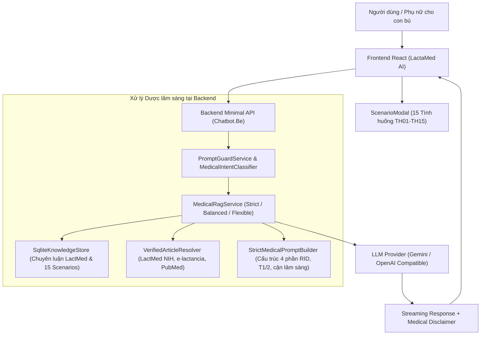

# Kế Hoạch Đồng Bộ Mã Nguồn Theo Đề Tài Chatbot AI Tư Vấn Thuốc Cho Phụ Nữ Cho Con Bú

## 1. Tóm tắt mục tiêu
Đồng bộ hóa 100% mã nguồn Backend và Frontend theo đúng đề tài "Chatbot AI tư vấn sử dụng thuốc cho phụ nữ cho con bú" (LactaMed AI), tuyệt đối không sửa đổi tài liệu báo cáo (`Docs/`).

## 2. Danh sách tệp tạo / chỉnh sửa
- [src/Chatbot.Be/Data/Storage/SqliteKnowledgeStore.cs](src/Chatbot.Be/Data/Storage/SqliteKnowledgeStore.cs)
- [src/Chatbot.Be/Rag/Services/VerifiedArticleResolver.cs](src/Chatbot.Be/Rag/Services/VerifiedArticleResolver.cs)
- [src/Chatbot.Be/Rag/Prompts/StrictMedicalPromptBuilder.cs](src/Chatbot.Be/Rag/Prompts/StrictMedicalPromptBuilder.cs)
- [src/Chatbot.Be/Rag/Services/MedicalRagService.cs](src/Chatbot.Be/Rag/Services/MedicalRagService.cs)
- [src/Chatbot.Fe/index.html](src/Chatbot.Fe/index.html)
- [src/Chatbot.Fe/src/components/Sidebar.tsx](src/Chatbot.Fe/src/components/Sidebar.tsx)
- [src/Chatbot.Fe/src/components/ChatArea.tsx](src/Chatbot.Fe/src/components/ChatArea.tsx)
- [src/Chatbot.Fe/src/components/MessageItem.tsx](src/Chatbot.Fe/src/components/MessageItem.tsx)
- [src/Chatbot.Fe/src/components/AuthModal.tsx](src/Chatbot.Fe/src/components/AuthModal.tsx)
- [src/Chatbot.Fe/src/components/AdminPortal.tsx](src/Chatbot.Fe/src/components/AdminPortal.tsx)
- [src/Chatbot.Be/storage/documents/](src/Chatbot.Be/storage/documents/)

## 3. Sơ đồ luồng xử lý

## 4. Danh sách công việc (Todo List)
- [x] Tạo file kế hoạch theo chuẩn AGENTS.md
- [x] Cập nhật 15 tình huống lâm sàng TH01-TH15 về tư vấn thuốc cho con bú và cơ chế tự động reseed trong `SqliteKnowledgeStore.cs`
- [x] Bổ sung chuyên luận LactMed vào `VerifiedArticleResolver.cs` cho các thuốc trong 15 tình huống (Ciprofloxacin, Metronidazole, Doxycycline, Chlorpheniramine, Betamethasone)
- [x] Giữ nguyên thương hiệu Health Care chuẩn mực trên toàn bộ Frontend và Backend prompts theo chỉ định của người dùng
- [x] Chuyển đổi định vị từ "kiểm chứng tin đồn mạng xã hội" sang "Tình huống lâm sàng tư vấn dùng thuốc khi cho con bú"
- [x] Dọn dẹp tài liệu lạc đề DMD và bổ sung chuyên luận cơ sở mẫu (Ibuprofen, Amoxicillin, Pseudoephedrine)
- [x] Biên dịch dự án, build Frontend sang wwwroot và kiểm thử xác minh API scenarios
