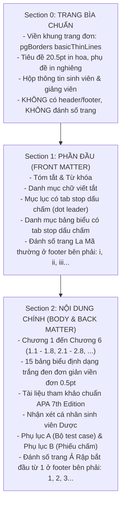

# Kế Hoạch Định Dạng Báo Cáo Đề Tài 67 Chuẩn Mẫu Huỳnh Tấn Lộc (Trắng Đen, Đánh Số Trang, Bìa & Mục Lục Chuẩn)

## 1. Tóm Tắt Mục Tiêu
Rà soát và định dạng lại toàn bộ báo cáo Đề tài 67 ("Trợ lý AI hỗ trợ kiểm chứng thông tin thuốc trên Internet dành cho sinh viên Dược") sao cho trùng khớp 100% về form dáng, cấu trúc phân trang, bìa viền khung, mục lục có dấu chấm tab stop và đánh số trang so với tệp mẫu thực tế `Docs/Report/example/Huỳnh Tấn Lộc.docx`.
Toàn bộ tài liệu tuân thủ nghiêm ngặt yêu cầu "trắng đen thôi, không cầu kỳ, đúng form mẫu, thay nội dung vào", xuất tệp hoàn chỉnh vào `Docs/Report/final/Bao_Cao_De_Tai_67_Full_Final.docx` và `Docs/Report/final/Bao_Cao_De_Tai_67_Full_Final.md`.

## 2. Danh Sách Tệp Sẽ Tạo Và Cập Nhật
- Tệp báo cáo hoàn chỉnh (Master Report):
  - `[Docs/Report/final/Bao_Cao_De_Tai_67_Full_Final.docx](Docs/Report/final/Bao_Cao_De_Tai_67_Full_Final.docx)`: Tệp Word chính thức xuất chuẩn in ấn (3 phần section, bìa viền khung, số trang La Mã i, ii, iii... cho phần đầu và số Ả Rập 1, 2, 3... cho phần nội dung, bảng biểu viền đen trắng đơn giản).
  - `[Docs/Report/final/Bao_Cao_De_Tai_67_Full_Final.md](Docs/Report/final/Bao_Cao_De_Tai_67_Full_Final.md)`: Tệp Markdown toàn văn đối ứng.
- Tệp kịch bản sinh tài liệu:
  - `[generate_exact_sample_docx.py](generate_exact_sample_docx.py)`: Kịch bản Python tự động trích xuất template mẫu từ `Huỳnh Tấn Lộc.docx`, kế thừa toàn bộ styles (`TIÊU ĐỀ`, `Heading 1`, `Heading 2`, `TOC1`, `TOC2`, `Footer`, `Header`, `Normal`), cấu trúc 3 section và xây dựng tài liệu chuẩn xác.

## 3. Sơ Đồ Kiến Trúc Phân Đoạn Tài Liệu Chuẩn Mẫu

## 4. Các Nguyên Tắc Thiết Kế Áp Dụng (Poteto Mode & Principles)
- **Minimize Reader Load (`principle-minimize-reader-load`):** Bỏ toàn bộ màu mè cầu kỳ (màu nền navy, viền xanh, chữ xanh), chuyển sang định dạng đen trắng chuẩn mực học thuật y khoa của các trường đại học tại Việt Nam. Bảng biểu sử dụng viền đơn đen mỏng (`0.5pt`), tiêu đề bảng chữ đậm trên nền trắng sạch sẽ.
- **Foundational Thinking (`principle-foundational-thinking`):** Tận dụng trực tiếp cấu trúc XML của tệp mẫu `Huỳnh Tấn Lộc.docx` để nhân bản chính xác:
  1. Section 0: `pgBorders` bao quanh trang bìa, loại bỏ hoàn toàn số trang.
  2. Section 1: `pgNumType fmt="lowerRoman" start="1"`, footer gắn trường `PAGE` căn phải.
  3. Section 2: `pgNumType start="1"`, footer gắn trường `PAGE` căn phải.
  4. Mục lục và Danh mục bảng sử dụng đúng tab stop `pos="9350"` với ký tự dẫn đường dấu chấm (`leader="dot"`), tạo hiệu ứng hàng chấm nối thẳng đến số trang như sách xuất bản.
- **Prove It Works (`principle-prove-it-works`):** Kiểm tra tệp `.docx` đầu ra bằng kịch bản Python kiểm chứng độc lập: đo đếm số trang thực tế, xác minh sự hiện diện của trường số trang La Mã và số Ả Rập, kiểm tra viền khung bìa và bảng biểu không chứa mã màu trang trí.

## 5. Danh Sách Công Việc Chi Tiết (Todo List)
- [ ] Task 1: Khảo sát chi tiết mã XML của 3 section, footer và borders từ `Docs/Report/example/Huỳnh Tấn Lộc.docx`.
- [ ] Task 2: Soạn thảo mã Python xây dựng tài liệu Word Đề tài 67 kế thừa trực tiếp cấu trúc 3 section, footer La Mã/Ả Rập, tab stop Mục lục và bảng trắng đen đơn giản.
- [ ] Task 3: Chạy script tạo tệp `Docs/Report/final/Bao_Cao_De_Tai_67_Full_Final.docx` và đồng bộ tệp `Docs/Report/final/Bao_Cao_De_Tai_67_Full_Final.md`.
- [ ] Task 4: Chạy script kiểm tra độc lập cấu trúc XML, số đoạn văn, bảng biểu, footer và xác nhận tính toàn vẹn trước khi hoàn thành.
