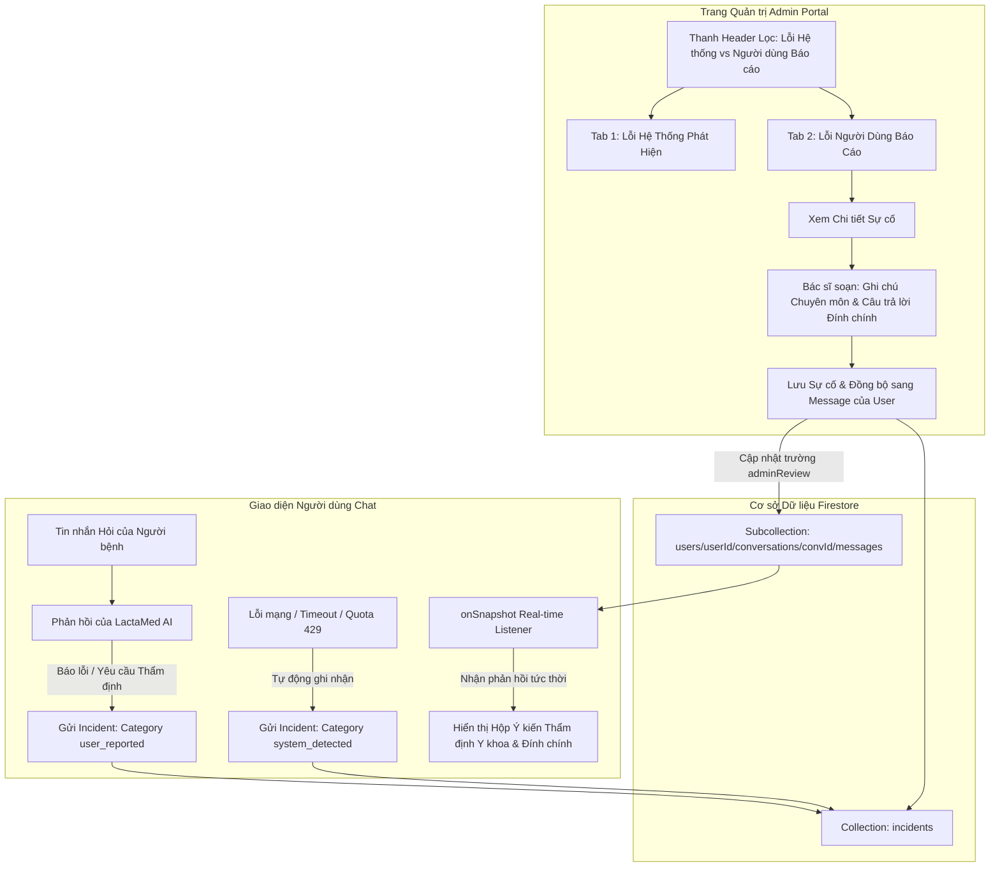

# Kế hoạch Hoàn thiện Tính năng Báo cáo Sự cố và Thẩm định Y khoa Hai Chiều

## 1. Bối cảnh và Yêu cầu Kỹ thuật
Hiện tại, người dùng gửi báo cáo sự cố qua nút phản ánh nhưng chưa có liên kết chặt chẽ với định danh tin nhắn (`messageId`), dẫn đến việc khi quản trị viên/bác sĩ thẩm định, ghi chú hoặc soạn câu trả lời đính chính trong Admin Portal thì người dùng bên giao diện chat không nhìn thấy được. Đồng thời, tab Sự cố (Incidents) trong Admin Portal chưa có thanh phân loại rõ ràng giữa sự cố do hệ thống tự phát hiện (timeout, quota 429, ngoại lệ) và sự cố do người dùng gửi báo cáo.

## 2. Kiến trúc Luồng Dữ liệu Hai Chiều

## 3. Các Tệp Sẽ Tạo Mới và Chỉnh Sửa

- `[Labs/Components/Chatbot_v1/src/Chatbot.Fe/src/services/api.ts](Labs/Components/Chatbot_v1/src/Chatbot.Fe/src/services/api.ts)`:
  - Bổ sung interface `AdminReviewInfo` lưu trữ thông tin thẩm định của bác sĩ: `status`, `notes`, `correctedResponse`, `evaluatedAt`, `adminEmail`.
  - Cập nhật interface `ChatMessage` thêm trường `adminReview?: AdminReviewInfo`.

- `[Labs/Components/Chatbot_v1/src/Chatbot.Fe/src/services/firebase.ts](Labs/Components/Chatbot_v1/src/Chatbot.Fe/src/services/firebase.ts)`:
  - Cập nhật `IncidentRecord`: Thêm `category: 'system_detected' | 'user_reported'` và `messageId?: string`.
  - Hàm `saveChatMessage`: Trả về `docRef.id` để mã nguồn lưu trữ đúng ID tin nhắn.
  - Bổ sung hàm `subscribeConversationMessages(userId, convId, callback)` sử dụng `onSnapshot` lắng nghe tin nhắn theo thời gian thực để người dùng nhận được phản hồi của bác sĩ ngay khi lưu mà không cần tải lại trang.
  - Viết hàm `updateIncidentAndNotifyMessage(incidentId, updates, contextInfo)`: Cập nhật tài liệu trong collection `incidents`, đồng thời tự động cập nhật trường `adminReview` vào tài liệu tin nhắn tương ứng tại `users/{userId}/conversations/{convId}/messages/{messageId}`.

- `[Labs/Components/Chatbot_v1/src/Chatbot.Fe/src/components/AdminPortal.tsx](Labs/Components/Chatbot_v1/src/Chatbot.Fe/src/components/AdminPortal.tsx)`:
  - Thiết kế thanh Header chuyển đổi ở đầu Tab Sự cố (Tab 2: Incidents):
    - Nút 1: Lỗi Hệ Thống Phát Hiện (kèm số đếm sự cố hệ thống).
    - Nút 2: Lỗi Người Dùng Báo Cáo (kèm số đếm khiếu nại của người dùng).
  - Tích hợp bộ lọc trạng thái (Tất cả, Chờ xử lý, Đang xem xét, Đã giải quyết).
  - Kết nối hành động lưu sự cố với `updateIncidentAndNotifyMessage`, đồng bộ phản hồi trực tiếp tới tin nhắn của người dùng.
  - Tại Tab 1 (Người dùng): Cho phép quản trị viên xem và gắn ý kiến thẩm định y khoa trực tiếp lên từng tin nhắn trong cuộc trò chuyện.

- `[Labs/Components/Chatbot_v1/src/Chatbot.Fe/src/components/MessageItem.tsx](Labs/Components/Chatbot_v1/src/Chatbot.Fe/src/components/MessageItem.tsx)`:
  - Cập nhật `handleReportSubmit`: Truyền đầy đủ `messageId: message.id`, `category: "user_reported"`.
  - Hiển thị hộp thông tin lâm sàng `AdminDoctorReviewCard` bên dưới tin nhắn khi `message.adminReview` tồn tại:
    - Tiêu đề: Ý kiến Thẩm định Chuyên môn từ Bác sĩ Quản trị.
    - Nhãn trạng thái: Đã đính chính y khoa / Đang xem xét.
    - Khối nội dung đính chính chuẩn y khoa (nếu bác sĩ soạn câu trả lời chuẩn).
    - Lời dặn / Ghi chú chuyên môn của bác sĩ gửi tới người bệnh.

- `[Labs/Components/Chatbot_v1/src/Chatbot.Fe/src/App.tsx](Labs/Components/Chatbot_v1/src/Chatbot.Fe/src/App.tsx)`:
  - Tích hợp `subscribeConversationMessages` khi người dùng chọn cuộc trò chuyện, đảm bảo phản hồi của bác sĩ hiển thị tức thì.
  - Bổ sung cơ chế tự động ghi nhận sự cố hệ thống (`category: 'system_detected'`) khi quá trình streaming chat bị lỗi kết nối hoặc gián đoạn mạng.

## 4. Kế hoạch Kiểm Thử

1. Kiểm thử Báo cáo từ Người dùng:
   - Gửi một câu hỏi trong chat, nhấn Báo cáo sự cố trên tin nhắn, điền lý do và gửi.
   - Kiểm tra trong Admin Portal: Mục "Lỗi Người Dùng Báo Cáo" tăng số lượng và xuất hiện thẻ sự cố vừa tạo.
2. Kiểm thử Tự động ghi nhận Lỗi Hệ thống:
   - Thử nghiệm kịch bản lỗi mạng hoặc timeout mô hình.
   - Kiểm tra trong Admin Portal: Sự cố tự động xuất hiện trong mục "Lỗi Hệ Thống Phát Hiện".
3. Kiểm thử Thanh Header Phân loại trong Admin Portal:
   - Nhấn chuyển đổi giữa "Lỗi Hệ Thống Phát Hiện" và "Lỗi Người Dùng Báo Cáo" để xác minh danh sách lọc chính xác.
4. Kiểm thử Bác sĩ Thẩm định và Đồng bộ Hai chiều:
   - Trong Admin Portal, chọn một sự cố của người dùng.
   - Nhập nội dung đính chính y khoa và lời dặn của bác sĩ, chọn trạng thái "Đã giải quyết", bấm Lưu.
   - Mở màn hình chat của người dùng: Hộp thẩm định chuyên môn của bác sĩ xuất hiện ngay dưới tin nhắn tương ứng với đầy đủ nội dung đính chính.
5. Kiểm thử Đóng gói và Triển khai:
   - Chạy `npm run build` trên frontend.
   - Sao chép bản build vào `wwwroot`, chạy `dotnet build` và kiểm thử container.
   - Commit và push lên nhánh `main` của repository `Chatbot-v1`.
