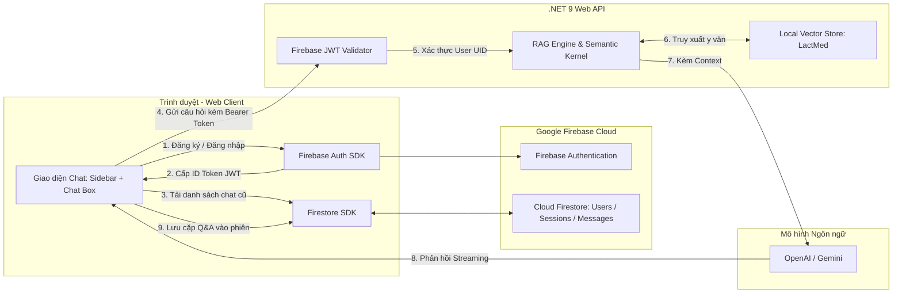

# ADR-0002: Tích hợp Firebase cho Xác thực Người dùng và Lưu trữ Lịch sử Chat

## Trạng thái
Đã chấp thuận (Accepted)

## Bối cảnh và Động lực
Sau khi xác lập kiến trúc cốt lõi cho pipeline RAG (ADR-0001), dự án cần bổ sung trải nghiệm người dùng tương tự như ChatGPT:
1. Người dùng có tài khoản cá nhân thông qua đăng ký, đăng nhập bằng Email/Password hoặc Google.
2. Lưu trữ danh sách các đoạn hội thoại (Conversation Threads) và toàn bộ tin nhắn (Chat Messages) theo từng người dùng.
3. Khi người dùng mở lại trang web hoặc đổi thiết bị, họ có thể xem lại lịch sử trò chuyện cũ ở thanh bên (Sidebar).

Thay vì phải tự xây dựng bảng dữ liệu tài khoản, xử lý băm mật khẩu, cấp phát refresh token, và dựng máy chủ cơ sở dữ liệu quan hệ phức tạp, nhóm xem xét tích hợp hệ sinh thái Firebase (Google).

## Quyết định Kiến trúc
Chúng tôi quyết định áp dụng **mô hình kiến trúc kết hợp (Hybrid Firebase + .NET RAG Service)**:

1. **Quản lý danh tính (Authentication):**
   * Sử dụng **Firebase Authentication** trên Frontend (hỗ trợ Email/Password và Google Sign-In chỉ với vài dòng code).
   * Khi gửi request hỏi đáp về Backend .NET, Frontend đính kèm Firebase ID Token qua header: `Authorization: Bearer <Firebase_JWT>`.
   * Backend .NET sử dụng gói `FirebaseAdmin` để xác minh token và trích xuất `User.UID`.

2. **Lưu trữ lịch sử hội thoại (Chat History Storage):**
   * Sử dụng **Cloud Firestore** với cấu trúc dữ liệu phân cấp:
     * `users/{userId}`: Thông tin người dùng cơ bản.
     * `users/{userId}/conversations/{conversationId}`: Danh sách các phiên trò chuyện (tiêu đề, thời gian tạo, thời gian cập nhật).
     * `users/{userId}/conversations/{conversationId}/messages/{messageId}`: Từng tin nhắn (`role: user | assistant`, `content`, `sources`, `timestamp`).
   * Sử dụng **Firestore Security Rules** đảm bảo người dùng chỉ được phép đọc và ghi dữ liệu thuộc về chính `request.auth.uid` của họ.

3. **Tách biệt dữ liệu Vector RAG:**
   * Dữ liệu y văn và Vector Store vẫn được lưu trữ và vận hành hoàn toàn ở Backend .NET (SQLite/In-Memory), không lưu tài liệu y tế khổng lồ vào Firestore để tối ưu chi phí và tăng tốc độ tìm kiếm tương đồng.

## Các Phương án Đã Cân nhắc

### 1. Tự làm cơ sở dữ liệu quan hệ (PostgreSQL / SQL Server + ASP.NET Identity)
* *Lý do từ chối:* Chi phí vận hành và cài đặt cao. Người chấm bài hoặc người dùng thử nghiệm phải cấu hình kết nối database, chạy migration Entity Framework, và quản lý bảng tài khoản thủ công.

### 2. Dùng Firebase gọi trực tiếp AI (Firebase Extensions / Client LLM call)
* *Lý do từ chối:* Bị lộ prompt hệ thống, lộ khóa API của mô hình ngôn ngữ, và không thể áp dụng các rào chắn kiểm duyệt y tế nghiêm ngặt (Closed-domain guardrails) ở tầng server.

## Hệ quả & Đánh đổi

### Tích cực (Pros)
* **Trải nghiệm chuẩn ChatGPT:** Người dùng có thanh bên hiển thị danh sách hội thoại cũ, nút "Cuộc trò chuyện mới" (New Chat), và đăng nhập 1-click bằng tài khoản Google.
* **Thời gian làm cực nhanh:** Firebase Auth và Firestore đã có sẵn SDK JavaScript chính thức, tích hợp giao diện chỉ mất vài giờ.
* **Đồng bộ thời gian thực (Real-time):** Lịch sử tin nhắn được đồng bộ tự động giữa các thiết bị mà không cần viết socket phía backend.
* **Gói miễn phí rộng rãi:** Hạn mức Spark Plan của Firebase hoàn toàn miễn phí cho các bài toán học tập, nghiên cứu và thử nghiệm đề tài.

### Hạn chế & Biện pháp giảm thiểu (Cons & Mitigations)
* *Hạn chế:* Cần thiết lập dự án trên Firebase Console và tải tệp cấu hình `firebaseConfig`.
* *Biện pháp:* Đính kèm tệp cấu hình mẫu `.env.example` hoặc `firebase-config.example.js` cùng hướng dẫn chi tiết từng bước tạo dự án Firebase trong tài liệu.
