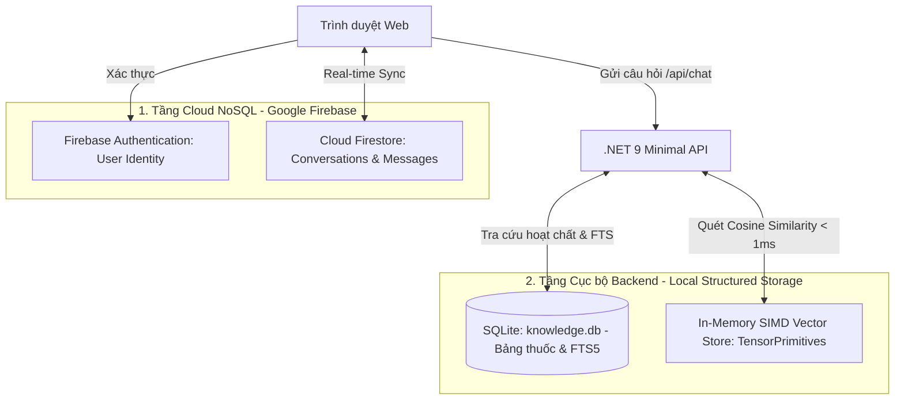

# ADR-0003: Chiến lược Cơ sở Dữ liệu Toàn diện và Danh mục Công nghệ Sử dụng

## Trạng thái
Đã chấp thuận (Accepted)

## Bối cảnh và Động lực
Hệ thống Chatbot_v1 có 4 nhóm dữ liệu mang đặc tính truy xuất, tần suất đọc/ghi và yêu cầu nhất quán hoàn toàn khác nhau:
1. **Dữ liệu Người dùng & Xác thực (Identity):** Thông tin định danh, tài khoản Google/Email, token phiên đăng nhập.
2. **Dữ liệu Lịch sử Trò chuyện (Chat History):** Danh sách cuộc hội thoại (conversations) và từng tin nhắn (messages) dạng cây phân cấp phi cấu trúc, cần đồng bộ thời gian thực (real-time) lên giao diện kiểu ChatGPT.
3. **Dữ liệu Hồ sơ Thuốc Y văn (Drug Monographs):** Dữ liệu dạng tài liệu y khoa chuẩn (tên hoạt chất, biệt dược, nồng độ sữa, cảnh báo), cần tìm kiếm chính xác tuyệt đối (Exact Match / FTS) theo tên thuốc.
4. **Dữ liệu Vector Đặc trưng (Embeddings):** Các vector số thực (ví dụ 1536 chiều) phục vụ tìm kiếm tương đồng ngữ nghĩa (Cosine Similarity) cho bài toán RAG.

Nếu cố ép cả 4 loại dữ liệu vào một hệ quản trị duy nhất (như chỉ dùng SQL Server hoặc chỉ dùng Firestore), hệ thống sẽ gặp các vấn đề:
* Chỉ dùng SQL truyền thống: Rất khó làm tính năng Real-time sync tin nhắn mượt mà như ChatGPT, tốn công dựng máy chủ database, chạy migration khi chấm bài/demo.
* Chỉ dùng Firestore: Không có tính năng tìm kiếm Vector miễn phí nội bộ (Firebase Vector Search yêu cầu nâng gói trả phí Google Cloud Vertex AI), tốc độ tìm kiếm vector phụ thuộc độ trễ mạng Internet.

## Quyết định Kiến trúc Cơ sở Dữ liệu (Multi-Tier Storage Strategy)

Chúng tôi quyết định áp dụng **Chiến lược Phân tầng Cơ sở Dữ liệu Chuyên biệt hóa (Specialized Multi-Tier Storage)**:



---

### Chi tiết từng Cơ sở Dữ liệu Được chọn

#### 1. Cloud Firestore (Lưu trữ Lịch sử Trò chuyện & Hội thoại)
* **Lý do chọn:**
  * Cấu trúc Document-oriented hoàn hảo cho dạng cây hội thoại (`User -> Conversation -> Messages`).
  * Cơ chế lắng nghe sự kiện thời gian thực (`onSnapshot`) giúp danh sách hội thoại ở Sidebar và tin nhắn chat cập nhật tức thì.
  * Tích hợp chặt chẽ với Firebase Auth bằng Firestore Security Rules:
    ```javascript
    match /users/{userId}/conversations/{convId}/{document=**} {
      allow read, write: if request.auth != null && request.auth.uid == userId;
    }
    ```
  * Hoàn toàn miễn phí (Gói Spark: 50.000 lượt đọc, 20.000 lượt ghi mỗi ngày — quá đủ cho đề tài).

#### 2. SQLite (`knowledge.db` - Lưu trữ Hồ sơ Y văn & Tra cứu Từ khóa)
* **Lý do chọn:**
  * Nhẹ, tự chứa trong 1 file duy nhất trong thư mục dự án, không cần cài đặt dịch vụ database.
  * Hỗ trợ bộ máy tìm kiếm toàn văn **FTS5 (Full-Text Search)**: Khi người dùng gõ biệt dược (ví dụ: "Panadol", "Hapacol", "Efferalgan"), SQLite FTS5 ánh xạ ngay về hoạt chất gốc "Paracetamol" với tốc độ dưới 0.1ms.
  * Độc lập, không bị ảnh hưởng khi mất kết nối mạng.

#### 3. In-Memory SIMD Vector Store (.NET 9 - Tìm kiếm Ngữ nghĩa RAG)
* **Lý do chọn:**
  * Quy mô dữ liệu y văn của đề tài là 100–300 loại thuốc thông dụng, tương đương khoảng 500–1.000 đoạn văn bản (chunks).
  * Trong .NET 9, thư viện `System.Numerics.Tensors.TensorPrimitives.CosineSimilarity` tận dụng tập lệnh phần cứng SIMD (AVX2, AVX-512, ARM Neon) để tính toán độ tương đồng giữa 1.000 vector chỉ mất **dưới 1 millisecond**.
  * **Loại bỏ hoàn toàn sự phụ thuộc vào các Vector DB đắt đỏ hoặc phức tạp** (như Pinecone, Milvus, Weaviate), giúp toàn bộ hệ thống khởi chạy chỉ với một lệnh `dotnet run`.

---

## Toàn bộ Danh mục Công nghệ Sử dụng (Full Tech Stack)

| Thành phần | Công nghệ / Thư viện | Vai trò cụ thể |
| :--- | :--- | :--- |
| **Nền tảng Backend** | .NET 9 (C#) Minimal API | Xây dựng RESTful API tốc độ cao, tiêu thụ ít RAM, quản lý luồng RAG. |
| **AI Orchestration** | Microsoft.SemanticKernel (v1.x) | SDK chính thức của Microsoft để quản lý Chat History, System Prompt và gọi LLM. |
| **Mô hình Ngôn ngữ (LLM)** | OpenAI `gpt-4o-mini` hoặc Google `gemini-1.5-flash` | Sinh câu trả lời dựa trên context được cung cấp với chi phí siêu rẻ và tốc độ nhanh. |
| **Mô hình Embedding** | OpenAI `text-embedding-3-small` | Chuyển đổi văn bản y tế thành vector đặc trưng 1536 chiều. |
| **Xác thực (Auth)** | Firebase Authentication | Đăng ký/đăng nhập Email và Google OAuth cho người dùng. |
| **Lưu trữ Chat** | Google Cloud Firestore | Lưu trữ các cuộc hội thoại, tin nhắn thời gian thực. |
| **Lưu trữ Y văn** | SQLite 3 (`Microsoft.Data.Sqlite`) | Lưu trữ bảng dữ liệu hoạt chất và chỉ mục tìm kiếm nhanh FTS5. |
| **Tìm kiếm Vector** | .NET SIMD (`TensorPrimitives`) | Tính Cosine Similarity trực tiếp trên bộ nhớ RAM. |
| **Giao diện Người dùng** | HTML5, CSS3, JavaScript (ES6 Modules) | Giao diện Single Page phong cách ChatGPT, chạy trực tiếp từ `wwwroot`. |
| **Thư viện Frontend phụ trợ** | `marked.js` (render Markdown), `feather-icons` | Hiển thị bảng, chữ đậm/nghiêng, icon giao diện trực quan. |

---

## So sánh với các Phương án Thay thế

### 1. PostgreSQL + pgvector
* *Đánh giá:* Rất tốt cho hệ thống doanh nghiệp lớn, nhưng với phạm vi đề tài này, PostgreSQL đòi hỏi người dùng/giảng viên phải cài đặt PostgreSQL Server, bật extension `pgvector`, chạy migration, tạo sự cồng kềnh không cần thiết khi chạy thử nghiệm trên máy khác.

### 2. Dùng Firebase Vector Search (Vertex AI Extension)
* *Đánh giá:* Đòi hỏi tài khoản Firebase phải nâng cấp lên gói Blaze (trả tiền qua thẻ tín dụng), phụ thuộc hoàn toàn vào hạ tầng đám mây Google Cloud, không phù hợp cho đồ án học tập/nghiên cứu.

### 3. Dùng Python ChromaDB làm dịch vụ riêng
* *Đánh giá:* Buộc máy tính phải chạy song song 2 dịch vụ: 1 server Python (chạy ChromaDB) và 1 server Web, gây rắc rối khi khởi động và quản lý tiến trình.

---

## Hệ quả Kiến trúc
* **Ưu điểm lớn nhất:** Dự án đạt tiêu chuẩn "Zero Configuration" cho phần Backend RAG (chỉ cần .NET SDK là chạy được ngay) kết hợp trải nghiệm Web hiện đại của Firebase mà không tốn bất kỳ chi phí bản quyền nào.
* **Yêu cầu duy nhất:** Cần tạo 1 project Firebase miễn phí và điền `firebaseConfig` vào file cấu hình giao diện.
