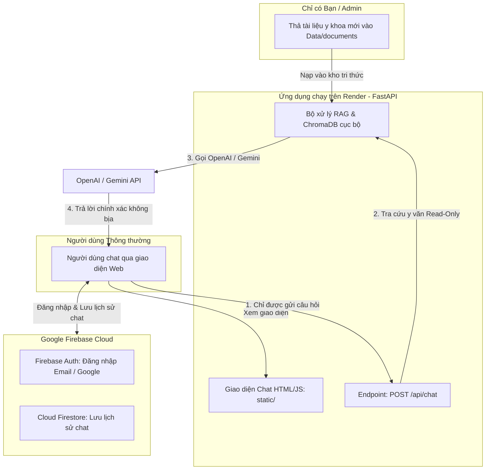

# ADR-0004: Tinh giản Kiến trúc, Phân quyền Tài liệu Read-only và Tối ưu Triển khai Render

## Trạng thái
Bị thay thế bởi ADR-0005 (Superseded by ADR-0005)

> *Ghi chú cập nhật:* Do yêu cầu kỹ thuật chốt từ người phát triển ("không sử dụng Python vì không quen cú pháp, ưu tiên sử dụng .NET / C# cho Backend và React cho Frontend, đồng thời cần tính năng Admin upload/xóa tài liệu có highlight trích dẫn"), kiến trúc được chuẩn hóa lại toàn diện trong [ADR-0005](ADR-0005-dotnet-react-admin-highlight-architecture.md).

## Bối cảnh và Động lực
Sau khi rà soát theo yêu cầu thực tế của người phát triển:
1. **Ưu tiên sự đơn giản tối đa:** Người phát triển không chuyên sâu về kỹ thuật hạ tầng phức tạp, cần một hệ thống tinh gọn, dễ hiểu, ít phát sinh lỗi vặt.
2. **Khả năng triển khai lên Render:** Hệ thống cần chạy mượt mà trên nền tảng đám mây Render (gói miễn phí giới hạn 512 MB RAM).
3. **Phân quyền tài liệu y tế:**
   * Cho phép nạp thêm tài liệu y văn trong quá trình vận hành để chatbot thông minh hơn.
   * **Tuyệt đối không cho phép người dùng thông thường sửa đổi hay can thiệp vào tài liệu**, tránh nguy cơ làm sai lệch tri thức y khoa.

## Quyết định Kiến trúc Tinh gọn

### 1. Lựa chọn Công nghệ: Chuyển sang Python (FastAPI) thay vì .NET phức tạp
* **Lý do chuyển đổi:**
  * **Trên Render:** Python là ngôn ngữ được hỗ trợ bản địa (Native Runtime). Chỉ cần 1 file `requirements.txt` và lệnh khởi chạy `uvicorn main:app --host 0.0.0.0 --port $PORT`, không cần viết `Dockerfile` hay cấu hình .NET SDK cồng kềnh.
  * **Tiết kiệm tài nguyên:** Ứng dụng FastAPI chỉ tiêu tốn ~120 MB RAM, hoàn toàn nằm trong mức an toàn của Render Free Tier (512 MB). (.NET thường ngốn nhiều RAM hơn và khởi động chậm hơn khi Render khởi động lại sau thời gian ngủ).
  * **Mã nguồn siêu ngắn:** Toàn bộ pipeline đọc tài liệu (PDF, TXT, Word) và RAG chỉ gói gọn trong khoảng 80–120 dòng code Python.

### 2. Kiến trúc Nạp Tài liệu Y văn (Admin Ingestion vs User Read-Only)
* **Khu vực lưu trữ tài liệu:** Thư mục `Data/documents/` nằm ở Backend.
* **Cơ chế nạp:** 
  * *Cách 1 (Đơn giản nhất - Khuyên dùng):* Bạn chỉ cần thả tệp tài liệu mới (.pdf, .txt, .docx) vào thư mục `Data/documents/` trên máy và đẩy lên GitHub. Render sẽ tự động build lại và nạp tri thức mới.
  * *Cách 2 (Qua API):* Cung cấp một endpoint `/api/admin/upload` được bảo vệ bằng mật khẩu bí mật (`ADMIN_SECRET_KEY` trong biến môi trường).
* **Bảo vệ tài liệu:** Người dùng thông thường **chỉ có duy nhất quyền gọi `/api/chat`**. Hệ thống hoàn toàn không có bất kỳ API hay nút giao diện nào cho phép người dùng sửa đổi, xóa bỏ hay ghi đè lên tài liệu y tế.

### 3. Giao diện & Firebase Tối giản
* **Giao diện:** HTML/CSS/JS thuần được đặt trong thư mục `static/` và phục vụ trực tiếp bởi FastAPI (`app.mount("/static", ...)`).
* **Firebase Auth & Lịch sử Chat:** Toàn bộ việc đăng ký, đăng nhập và lưu lịch sử trò chuyện được xử lý trực tiếp từ trình duyệt thông qua Firebase JavaScript SDK. 
* **Backend giữ vai trò đơn nhiệm:** Backend chỉ làm một việc duy nhất: Nhận câu hỏi $\rightarrow$ Tìm kiếm tài liệu trong kho y văn $\rightarrow$ Gọi LLM với Strict Prompt $\rightarrow$ Trả lời. Nhờ đó, Backend không cần cấu hình Firebase Service Account JSON phức tạp trên Render.

---

## Sơ đồ Vận hành Tinh gọn

---

## Hệ quả & Đánh đổi
* **Dễ bảo trì nhất:** Người không chuyên về lập trình sâu vẫn có thể đọc, hiểu và chỉnh sửa mã nguồn Python một cách dễ dàng.
* **Chi phí 0đ:** Vừa vặn hoàn toàn trên gói miễn phí của Render và Firebase.
* **An toàn tuyệt đối:** Kho tài liệu y khoa được đóng băng (read-only) trước mọi tương tác của người dùng cuối.
