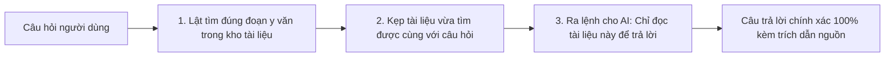

# Bài 00: Tổng Quan về Chatbot, RAG và Cơ Chế Chống Bịa Đặt

## 1. Chatbot là gì và Mô hình Ngôn ngữ Lớn (LLM) hoạt động ra sao?

Trước đây, các chatbot bạn thường gặp ở các trang bán hàng hoạt động theo dạng **"kịch bản bấm nút"**: người lập trình viết sẵn nếu khách gõ từ khóa "giá", bot sẽ trả lời câu A; nếu gõ "địa chỉ", bot trả lời câu B. Kiểu bot này rất cứng nhắc, người dùng chỉ cần hỏi khác một chữ là bot không hiểu.

Ngày nay, chúng ta có **Mô hình Ngôn ngữ Lớn (LLM - Large Language Model)** như ChatGPT (OpenAI), Claude, hay Gemini (Google). 
* LLM giống như một bộ não đã đọc hàng tỷ trang sách trên toàn bộ Internet.
* Nó có khả năng giao tiếp mượt mà, hiểu tiếng Việt rất tốt, hiểu được hàm ý câu nói của người dùng và diễn đạt câu trả lời vô cùng tự nhiên.

---

## 2. Vấn đề "Ảo giác" (Hallucination) - Con dao hai lưỡi trong Y tế

Dù rất thông minh, các LLM có một nhược điểm chí mạng: **Nó là mô hình sinh chữ dựa trên xác suất, chứ không phải cơ sở dữ liệu chân lý**.

Khi bạn hỏi một câu mà mô hình chưa được học kỹ, hoặc thông tin bị lẫn lộn, thay vì nói *"Tôi không biết"*, mô hình thường có xu hướng tự ghép nối các từ ngữ nghe có vẻ rất chuyên nghiệp, logic và tự tin nhưng nội dung bên trong lại **hoàn toàn sai sự thật**. Hiện tượng này trong ngành AI được gọi là **Ảo giác (Hallucination)**.

> **Ví dụ nguy hiểm:**
> * Người dùng hỏi: *"Thuốc kháng sinh X tôi đang uống có ảnh hưởng gì tới sữa cho bé 2 tháng tuổi không?"*
> * Một chatbot thông thường có thể tự tin bịa ra: *"Thuốc X rất an toàn, không qua sữa mẹ, chị cứ yên tâm uống nhé!"*
> * Nhưng trong y văn thực tế: Thuốc X có thể gây suy gan hoặc ngộ độc nghiêm trọng cho trẻ sơ sinh!

Trong lĩnh vực phụ nữ mang thai và nuôi con bằng sữa mẹ, sai một hoạt chất có thể đe dọa trực tiếp tới tính mạng của trẻ. Do đó, **tuyệt đối không được để LLM tự do bịa chữ**.

---

## 3. RAG là gì? Giải pháp "Thi mở sách"

Để giải quyết bài toán chống bịa đặt, người ta phát minh ra kỹ thuật **RAG (Retrieval-Augmented Generation - Tạo sinh tăng cường bằng truy xuất)**.

Hãy tưởng tượng một ví dụ ẩn dụ rất dễ hiểu:
* **LLM thông thường:** Giống như một học sinh đi thi **"đóng sách"**. Em học sinh này học rất rộng nhưng nhiều chỗ nhớ mang máng, khi thi gặp câu khó sẽ bắt đầu "chém gió" cho đủ ý.
* **Hệ thống RAG:** Giống như cho em học sinh đó đi thi **"mở sách"**. Trong phòng thi, chúng ta phát cho em đúng một cuốn sách chuẩn: **"Dược thư Quốc gia và Cẩm nang thuốc LactMed"**. 
  * Khi có câu hỏi về thuốc nào, trước tiên em phải **lật đúng trang sách** viết về loại thuốc đó (*Retrieval - Truy xuất*).
  * Đặt trang sách đó trước mặt em (*Augmentation - Tăng cường ngữ cảnh*).
  * Ra lệnh nghiêm ngặt: *"Em chỉ được đọc đúng những dòng có trên trang sách này để trả lời. Không có trong sách thì phải ghi 'Chưa có thông tin'. Cấm được bịa thêm bất kỳ chữ nào!"* (*Generation - Tạo sinh*).



---

## 4. Ba bước hoạt động cốt lõi của RAG

Hệ thống Chatbot_v1 của chúng ta vận hành chuẩn xác theo 3 bước:

1. **Bước 1 - Truy xuất (Retrieval):**
   * Người dùng hỏi: *"Uống Hapacol khi đang cho con bú có sao không?"*
   * Bộ tìm kiếm lục trong thư mục tài liệu y tế của bạn và rút ra đoạn văn bản về hoạt chất **Paracetamol** (Hapacol là tên thương mại của Paracetamol).
2. **Bước 2 - Tăng cường (Augmentation):**
   * Hệ thống đóng gói câu hỏi của người dùng kèm đoạn tài liệu vừa tìm được thành một đoạn chỉ dẫn (Prompt) gửi tới AI:
     ```text
     [TÀI LIỆU Y KHOA CHUẨN]:
     Paracetamol bài tiết vào sữa mẹ ở nồng độ cực thấp (dưới 2%). Được coi là tương thích và an toàn cho phụ nữ cho con bú...

     [CÂU HỎI]: Uống Hapacol khi đang cho con bú có sao không?
     [LỆNH]: Dựa duy nhất vào tài liệu trên, hãy trả lời câu hỏi và đưa ra lời khuyên.
     ```
3. **Bước 3 - Tạo sinh (Generation):**
   * AI đọc đoạn y văn trên, chuyển hóa thành câu trả lời dịu dàng, dễ hiểu cho người mẹ, kèm theo câu trích dẫn: *"Theo tài liệu LactMed, hoạt chất Paracetamol trong Hapacol là an toàn..."*.

---

## 5. Kết luận bài học
* Bạn không cần phải "huấn luyện" (train) lại mô hình AI tốn hàng trăm triệu đồng.
* Bạn chỉ cần chuẩn bị tài liệu thuốc chuẩn xác, kỹ thuật RAG sẽ biến mô hình AI thành một chuyên gia tra cứu sách y học cực kỳ trung thực, tin cậy và không bao giờ bịa đặt.
