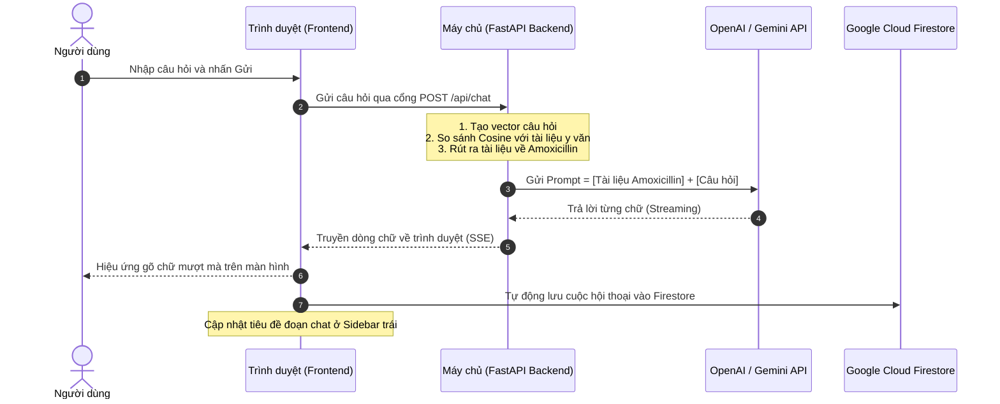

# Bài 04: Luồng Chạy Chi Tiết giữa Giao Diện và Máy Chủ

## 1. Bức Tranh Toàn Cảnh: Frontend và Backend là gì?

Để hiểu cách chatbot vận hành, bạn chỉ cần phân biệt 2 phần:
* **Frontend (Giao diện người dùng - đặt trong `static/`):** Là những gì người dùng nhìn thấy trên trình duyệt web (màu sắc, nút bấm, ô gõ tin nhắn, thanh lịch sử chat bên trái). Frontend chạy trực tiếp trên máy tính hoặc điện thoại của người dùng.
* **Backend (Máy chủ xử lý - file `main.py` và `rag.py`):** Là phần "bộ não" chạy ngầm trên máy chủ Render. Nó giữ nhiệm vụ đọc tài liệu y khoa bí mật, tính toán vector và gọi các mô hình AI.

Hai phần này nói chuyện với nhau thông qua các yêu cầu mạng (gọi là **API Request**).

---

## 2. Nhật Ký 7 Bước Diễn Ra Khi Người Dùng Gửi 1 Câu Hỏi

Hãy xem điều gì xảy ra trong vòng chưa đầy 1 giây khi một người mẹ gõ: *"Em bị đau họng uống Amoxicillin được không?"* rồi nhấn Enter:

### Giải thích chi tiết từng bước:

#### Bước 1: Trình duyệt gửi câu hỏi
* Giao diện JavaScript thu thập câu chữ của người dùng và gửi một gói tin HTTP tới Backend tại địa chỉ `/api/chat`.

#### Bước 2: Máy chủ chuyển câu hỏi thành tọa độ Vector
* Backend gọi hàm embedding để biến câu *"Em bị đau họng uống Amoxicillin được không?"* thành một dãy số tọa độ ý nghĩa.

#### Bước 3: Quét tìm kiếm tài liệu tương thích (Retrieval)
* Backend dùng thư viện toán học `numpy` quét siêu tốc qua hàng trăm đoạn tài liệu y văn trong thư mục `Data/documents/`.
* Hệ thống tìm thấy đoạn tài liệu nói về hoạt chất **Amoxicillin** có điểm tương đồng cao nhất (ví dụ: đạt 0.92 điểm).

#### Bước 4: Lắp ghép câu lệnh nghiêm ngặt (Prompt Construction)
* Backend ráp đoạn tài liệu y khoa tìm được vào bộ quy tắc ứng xử chuẩn:
  * *"Chỉ được trả lời dựa trên tài liệu về Amoxicillin này."*
  * *"Nêu rõ mức độ an toàn cho con bú."*
  * *"Nếu tài liệu không nói, cấm được tự ý phỏng đoán."*
  * *"Bắt buộc kèm cảnh báo miễn trừ trách nhiệm y tế."*

#### Bước 5 & 6: AI trả lời và hiển thị dòng chữ chạy (Streaming)
* Mô hình AI (OpenAI `gpt-4o-mini` hoặc Gemini) đọc lệnh và sinh câu trả lời.
* Backend không đợi AI nghĩ xong toàn bộ câu trả lời mà truyền ngay từng chữ về trình duyệt (*Server-Sent Events*).
* Trên màn hình của người mẹ, câu trả lời hiện ra dần dần từng từ một mượt mà hệt như khi dùng ChatGPT thật.

#### Bước 7: Lưu vào lịch sử Firebase Firestore
* Ngay sau khi bot hoàn thành câu trả lời, đoạn mã JavaScript trên trình duyệt sẽ tự động ghi câu hỏi và câu trả lời này vào **Google Cloud Firestore**.
* Tiêu đề cuộc trò chuyện (ví dụ: *"Tư vấn Amoxicillin"*) xuất hiện ngay lập tức ở cột bên trái (Sidebar) để người dùng có thể nhấp vào đọc lại bất kỳ lúc nào.

---

## 3. Điểm Độc Đáo: Cùng Chung Một Nhà (Same-Origin)
Vì mã nguồn Backend FastAPI của chúng ta phục vụ trực tiếp các file giao diện trong thư mục `static/`, toàn bộ hệ thống chạy chung trên một đường link duy nhất (ví dụ: `https://ten-du-an.onrender.com`).
* Bạn không bị các lỗi chặn mạng (CORS).
* Người dùng chỉ cần vào đúng một đường link là có đầy đủ cả giao diện lẫn máy chủ AI hoạt động trơn tru.
