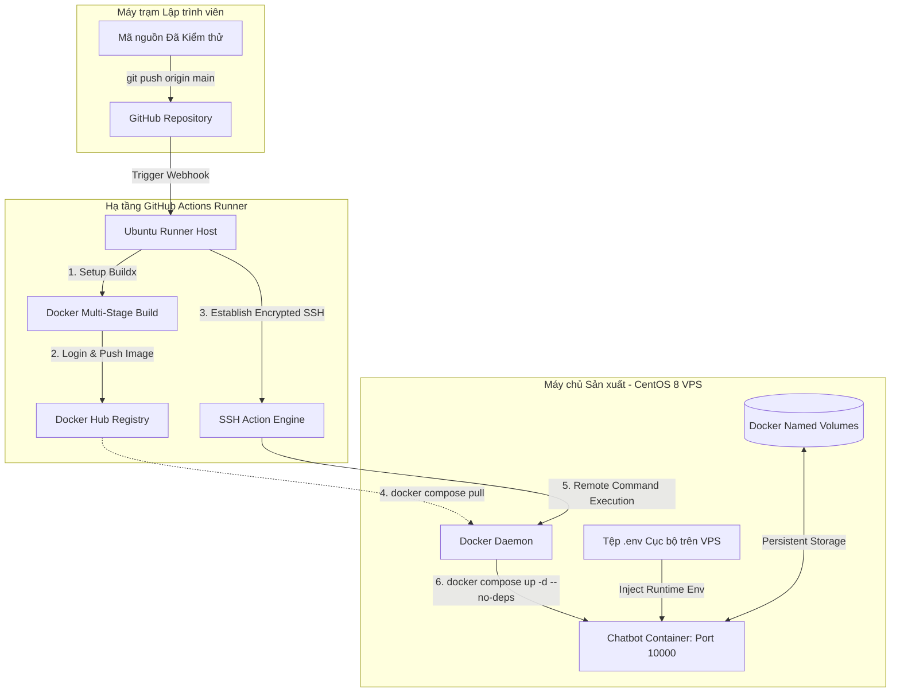

# Quy trình CI/CD Tự động hóa Triển khai Docker và VPS

## Context
- **Bối cảnh phát sinh:** Trong các hệ thống dịch vụ hiện đại, việc triển khai ứng dụng bằng phương pháp thủ công (kéo mã nguồn trực tiếp về máy chủ VPS, cài đặt SDK môi trường, biên dịch thủ công và khởi động lại dịch vụ) gây ra ba vấn đề nghiêm trọng:
  1. *Lãng phí tài nguyên máy chủ:* VPS phục vụ production phải tiêu tốn CPU/RAM để biên dịch Node.js và .NET thay vì dồn toàn lực phục vụ lưu lượng người dùng.
  2. *Lệch pha môi trường (Configuration Drift):* Môi trường phát triển cục bộ và môi trường máy chủ sản xuất có phiên bản runtime khác nhau, dẫn tới lỗi phát sinh không thể tái hiện.
  3. *Thời gian chết (Downtime) và rủi ro gián đoạn:* Quá trình build và khởi chạy đè lên tiến trình đang chạy gây sập dịch vụ đối với người dùng đang tương tác.
- **Xung đột động lực (Forces):**
  - *Tự động hóa hoàn toàn vs An toàn kiểm soát Secrets:* Cần đẩy bản build mới nhanh nhất mà không được phép lộ khóa API, mật khẩu cơ sở dữ liệu hay khóa SSH vào mã nguồn Git hoặc Docker image.
  - *Độc lập tiến trình vs Tối ưu tài nguyên VPS:* Quá trình cập nhật ứng dụng phải tự động khởi động lại đúng container mong muốn mà không gây ảnh hưởng hay khởi động lại các container khác cùng chạy trên VPS (như cơ sở dữ liệu, proxy, ứng dụng khác).
- **Bề mặt tấn công (Attack Surface):**
  - Rò rỉ khóa bí mật thông qua việc chèn trực tiếp tệp `.env` hoặc `ARG`/`ENV` trong Dockerfile lên các registry công khai.
  - Tấn công dò mật khẩu SSH (Brute-force) nếu mở cổng SSH và sử dụng phương thức xác thực mật khẩu yếu.

## Topology
- **Sơ đồ cấu trúc tổng thể (Architecture Diagram):**


- **Vai trò và Trách nhiệm của từng thành phần:**
  - *GitHub Actions Runner:* Môi trường máy ảo độc lập chịu trách nhiệm tải mã nguồn, biên dịch ứng dụng (.NET 8 & React Vite) trong môi trường Docker đa tầng (Multi-stage build), đóng gói thành Docker Image chuẩn và đẩy lên kho chứa Docker Hub.
  - *Docker Hub Registry:* Kho lưu trữ các Docker image đã đóng gói hoàn chỉnh, hỗ trợ đánh tag phiên bản (`:latest`, `:v1.x`) và phân phối image cho máy chủ production.
  - *Appleboy SSH Engine:* Trình điều khiển kết nối SSH được xác thực bằng cặp khóa mã hóa bất đối xứng (Ed25519 Private Key) nhằm gửi các chỉ thị điều khiển từ xa an toàn tới VPS mà không cần mở các cổng dịch vụ không an toàn.
  - *Docker Compose trên VPS:* Nhận chỉ thị qua SSH, thực hiện kéo image mới nhất từ Docker Hub về máy chủ, tái khởi động riêng container chỉ định (`--no-deps`) và gắn kết với các tệp cấu hình `.env` sẵn có tại máy chủ.
  - *Docker Named Volumes:* Vùng lưu trữ bền vững độc lập do Docker Daemon quản lý, giúp bảo toàn dữ liệu y văn và cơ sở dữ liệu SQLite/Qdrant qua các lần cập nhật image mà không phụ thuộc vào hệ thống tệp host.

## Workflows
- **Kịch bản thành công (Happy Path):**
  1. *Kích hoạt luồng (Trigger):* Lập trình viên hoàn thành tính năng và thực hiện `git push origin main`. GitHub kiểm tra bộ lọc đường dẫn và kích hoạt workflow `deploy.yml`.
  2. *Build & Đóng gói (Packaging):* GitHub Runner khởi tạo Docker Buildx, đọc `Dockerfile`, biên dịch React sang tĩnh tại `/app/fe/dist`, biên dịch ASP.NET Core sang `/app/publish`, sau đó hợp nhất vào base image `aspnet:8.0` tinh gọn.
  3. *Đẩy image (Push):* Runner xác thực vào Docker Hub qua `DOCKERHUB_USERNAME` và `DOCKERHUB_TOKEN`, gắn tag image `username/chatbot_v1:latest` và hoàn tất đẩy image.
  4. *Kích hoạt triển khai (Deploy Trigger):* Action khởi tạo kênh truyền SSH tới IP VPS (`VPS_HOST`) trên cổng chỉ định (`VPS_PORT`) với tài khoản `VPS_USERNAME` bằng khóa `VPS_SSH_KEY`.
  5. *Tải và Chạy cập nhật (Pull & Recreate):* VPS thực hiện:
     ```bash
     cd ~/yuikiri/chatbot_v1 || exit 1
     docker compose pull chatbot-app
     docker compose up -d --no-deps chatbot-app
     ```
  6. *Kiểm tra Sức khỏe (Healthcheck):* Container mới chạy lên, Docker Daemon kiểm tra định kỳ endpoint `/api/health`. Khi trạng thái đạt `healthy`, hệ thống ghi nhận thành công và kết thúc job với chấm xanh trên GitHub.

- **Kịch bản lỗi & Bồi hoàn (Failure & Compensation):**
  - *Lỗi xác thực SSH (`attempted methods [none]`):* Xảy ra khi SSH client không tìm thấy khóa hợp lệ hoặc máy chủ VPS tắt `PasswordAuthentication`. Khắc phục bằng cách nạp Ed25519 Private Key chuẩn vào GitHub Secrets `VPS_SSH_KEY` và cấp quyền `600` cho `authorized_keys` trên máy chủ.
  - *Lỗi hết dung lượng đĩa (Disk Exhaustion):* Khi nhiều bản build cũ tích tụ, Docker Daemon có thể bị đầy bộ nhớ. Khắc phục bằng cách thiết lập tác vụ dọn dẹp an toàn chỉ xóa các image không tên (`docker image prune -f` có gắn nhãn chọn lọc) hoặc cấu hình giới hạn kích thước log của container (`max-size: 50m`).
  - *Lỗi khởi động container (CrashLoopBackOff):* Nếu container mới bị lỗi runtime, Docker Compose giữ nguyên dữ liệu trong Named Volumes; người dùng có thể can thiệp rollback nhanh bằng cách sửa tag image về bản trước đó và chạy `$DC up -d`.

- **Biện pháp phòng vệ (Defense & Mitigation):**
  - Tuyệt đối không lưu tệp `.env` hay mật khẩu thực vào Git repo. Tệp `.dockerignore` bắt buộc loại bỏ `**/.env`, `**/*.db`, `**/storage/`.
  - Mọi biến nhạy cảm dùng cho CI/CD được mã hóa trong **GitHub Repository Secrets**.
  - Kết nối VPS chỉ chấp nhận SSH Key loại Ed25519 (chống lại các lỗ hổng phân rã của RSA cũ).

## Trade-offs
- **Lợi ích kiến trúc (Architectural Gains):**
  - *Tốc độ và Độ tin cậy:* Toàn bộ gánh nặng biên dịch chuyển sang GitHub Cloud Runner miễn phí. VPS chỉ mất từ 3 đến 5 giây để kéo image về và khởi động lại container.
  - *Tính cô lập hoàn hảo:* Việc cập nhật container Chatbot không làm gián đoạn hay ảnh hưởng tới bất kỳ container nào khác đang chạy trên cùng một máy chủ VPS.
  - *Tính tái lập (Reproducibility):* Image đã build thành công trên GitHub đảm bảo chạy giống hệt nhau ở bất kỳ đâu.
- **Cái giá vận hành (The Cost & Overhead):**
  - Tiêu tốn băng thông mạng tải image giữa GitHub $\rightarrow$ Docker Hub $\rightarrow$ VPS.
  - Cần duy trì các Secrets và thời hạn hết hạn của Personal Access Token trên Docker Hub.
- **Cảnh báo Anti-Pattern:**
  - *Anti-Pattern 1: Dùng lệnh `docker image prune -a -f` không chọn lọc:* Lệnh này sẽ xóa toàn bộ các image của các container khác đang tạm dừng trên VPS, gây hỏng hóc các hệ thống liên quan.
  - *Anti-Pattern 2: Dùng lệnh `docker compose down` rồi mới `up`:* Làm phát sinh thời gian chết (downtime) kéo dài trong lúc chờ kéo image. Cách đúng là chạy `pull` trước, sau đó `up -d --no-deps` để Docker tự động hoán đổi container trong vài mili-giây.

## Relations
- Tri thức liên quan:
  - [[Cloudflare-DNS-and-Edge-Proxy-Integration]] — Cấu hình lớp bảo vệ mạng và SSL trước khi lưu lượng đi vào VPS.
  - [[Domain-Mapping-and-SSL-Certificate-Setup]] — Định tuyến Nginx Reverse Proxy trên máy chủ VPS đón các cổng dịch vụ.
