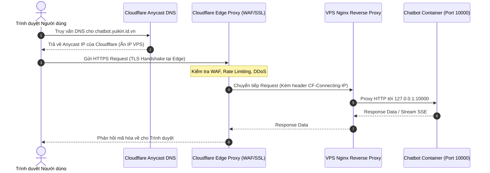

# Tích hợp Quản lý DNS và Edge Reverse Proxy qua Cloudflare

## Essence
- **Định nghĩa 1 câu:** Cloudflare là dịch vụ trung gian kết hợp giữa hệ thống máy chủ định danh toàn cầu (Anycast DNS) và mạng lưới máy chủ ủy nhiệm biên (Edge Reverse Proxy) đóng vai trò lá chắn phía trước hạ tầng máy chủ gốc (Origin Server).
- **Vấn đề kỹ thuật giải quyết:** 
  1. *Che giấu IP máy chủ gốc:* Ngăn chặn kẻ tấn công biết trực tiếp địa chỉ IP thật của VPS, triệt tiêu nguy cơ tấn công từ chối dịch vụ (DDoS) tầng mạng (L3/L4) và tầng ứng dụng (L7).
  2. *Tăng tốc độ phân giải và phân phối nội dung:* Tận dụng mạng lưới Anycast định tuyến truy vấn DNS tới trung tâm dữ liệu gần người dùng nhất và lưu đệm (cache) tài nguyên tĩnh.
  3. *Tự động hóa quản lý vòng đời TLS/SSL:* Đảm bảo kết nối từ trình duyệt đến máy chủ luôn được mã hóa mà không cần lo lắng về sự cố hết hạn chứng chỉ trên trình duyệt.
- **Mô hình trực giác (Mental Model):** Cloudflare giống như một trạm kiểm soát hải quan và phòng tiếp khách đặt ngoài cửa một khu quân sự bí mật. Khách bên ngoài chỉ được giao dịch tại trạm hải quan mà không bao giờ biết được tọa độ chính xác của căn cứ bên trong.

## Mechanics
- **Quy trình tương tác:**


- **Các bước Ủy quyền Quản lý Tên miền (Nameserver Delegation):**
  1. *Khởi tạo Zone trên Cloudflare:* Đăng ký tài khoản tại `dash.cloudflare.com`, chọn **Add a Site**, điền tên miền chính (ví dụ: `yuikiri.id.vn`). Chọn gói dịch vụ Free.
  2. *Nhận cặp Nameserver được phân bổ:* Cloudflare cung cấp 2 địa chỉ máy chủ định danh dạng:
     - `ns1.cloudflare.com` (ví dụ: `amy.ns.cloudflare.com`)
     - `ns2.cloudflare.com` (ví dụ: `bob.ns.cloudflare.com`)
  3. *Cập nhật tại Nhà đăng ký (Mắt Bão):*
     - Đăng nhập trang quản trị Mắt Bão (`id.matbao.net`) $\rightarrow$ Chọn tên miền `yuikiri.id.vn` $\rightarrow$ Chọn **Thay đổi Nameserver / Cấu hình máy chủ tên miền**.
     - Xóa các NS cũ của Mắt Bão (ví dụ: `ns1.matbao.vn`) và điền chính xác 2 NS do Cloudflare cấp.
  4. *Xác thực và Lan truyền (Propagation):* Quá trình chuyển giao NS diễn ra trong 5 phút đến 24 giờ tùy thuộc vào giá trị TTL cũ. Khi hoàn tất, Cloudflare sẽ gửi email kích hoạt trạng thái "Active".

- **Chế độ Proxy (Đám mây cam vs Đám mây xám):**
  - *Proxy status: Proxied (Đám mây cam):* Mọi truy vấn phân giải domain sẽ trả về IP của Cloudflare. Lưu lượng web bắt buộc đi qua bộ lọc của Cloudflare trước khi đến VPS. Toàn bộ tính năng WAF, DDoS Protection, Caching và SSL Edge được kích hoạt.
  - *Proxy status: DNS only (Đám mây xám):* Cloudflare chỉ hoạt động như một máy chủ DNS thuần túy, trả về địa chỉ IP gốc thật của VPS. Tắt hoàn toàn bộ đệm và tính năng ẩn IP. Thường chỉ dùng cho các bản ghi SSH, FTP hoặc mail server (MX).

- **Vòng đời & Trạng thái Mã hóa SSL/TLS (Encryption Modes):**
  - *1. Chế độ Off:* Vô hiệu hóa mã hóa, toàn bộ luồng truyền là HTTP thuần.
  - *2. Chế độ Flexible:*
    - Trình duyệt $\leftrightarrow$ Cloudflare: HTTPS (có khóa xanh).
    - Cloudflare $\leftrightarrow$ VPS Origin: HTTP thuần qua cổng 80.
    - *Cảnh báo nguy hiểm:* Nếu phía Nginx VPS cấu hình luật ép chuyển hướng `return 301 https://$host$request_uri;`, hệ thống sẽ rơi vào **Vòng lặp Chuyển hướng Vô tận (ERR_TOO_MANY_REDIRECTS)**.
  - *3. Chế độ Full:*
    - Trình duyệt $\leftrightarrow$ Cloudflare: HTTPS.
    - Cloudflare $\leftrightarrow$ VPS Origin: HTTPS (cổng 443).
    - Cho phép VPS sử dụng chứng chỉ tự ký (Self-signed) hoặc chứng chỉ chưa được kiểm định.
  - *4. Chế độ Full (Strict) (Chuẩn Khuyên Dùng):*
    - Yêu cầu máy chủ VPS Origin phải cài đặt chứng chỉ SSL hợp lệ và còn hạn (do Let's Encrypt hoặc Cloudflare Origin CA cấp). Đảm bảo mã hóa đầu cuối (End-to-End Encryption) an toàn tuyệt đối.

## Contract
- **Quy tắc cấu hình bản ghi DNS (DNS Record Layout):**
  | Type | Name / Host | Content / Target | Proxy Status | Ý nghĩa |
  | :--- | :--- | :--- | :--- | :--- |
  | `A` | `@` | `<IP_VPS>` | Proxied (Cam) | Trỏ tên miền gốc `yuikiri.id.vn` về VPS qua lá chắn Cloudflare |
  | `A` | `chatbot` | `<IP_VPS>` | Proxied (Cam) | Tạo subdomain `chatbot.yuikiri.id.vn` trỏ về VPS |
  | `CNAME` | `www` | `yuikiri.id.vn` | Proxied (Cam) | Chuyển tiếp định danh bí danh WWW |

- **HTTP Request Headers do Cloudflare bổ sung vào Origin:**
  - `CF-Connecting-IP`: Chứa địa chỉ IP thực của người dùng cuối (Client IP).
  - `X-Forwarded-For`: Danh sách IP client và proxy trung gian.
  - `CF-Ray`: Mã định danh duy nhất cho mỗi yêu cầu HTTP phục vụ điều tra lỗi.
  - `CF-Visitor`: Mô tả giao thức client sử dụng (`{"scheme":"https"}`).

- **Cấu hình Nginx khôi phục IP thật (Restore Real IP):**
  Để log của Nginx và ứng dụng .NET ghi nhận đúng IP người dùng thay vì ghi nhận IP của Cloudflare, thêm vào `/etc/nginx/conf.d/cloudflare_realip.conf`:
  ```nginx
  # Danh sách dải IP hợp lệ của Cloudflare Edge
  set_real_ip_from 173.245.48.0/20;
  set_real_ip_from 103.21.244.0/22;
  set_real_ip_from 103.22.200.0/22;
  set_real_ip_from 103.31.4.0/22;
  set_real_ip_from 141.101.64.0/18;
  set_real_ip_from 108.162.192.0/18;
  set_real_ip_from 190.93.240.0/20;
  set_real_ip_from 188.114.96.0/20;
  set_real_ip_from 197.234.240.0/22;
  set_real_ip_from 198.41.128.0/17;
  set_real_ip_from 162.158.0.0/15;
  set_real_ip_from 104.16.0.0/13;
  set_real_ip_from 104.24.0.0/14;
  set_real_ip_from 172.64.0.0/13;
  set_real_ip_from 131.0.72.0/22;

  real_ip_header CF-Connecting-IP;
  ```

## Trade-offs
- **Lợi ích kiến trúc (Architectural Gains):**
  - Giảm tải tới 60% băng thông và tài nguyên CPU của máy chủ VPS nhờ tính năng tự động nén (Brotli/Gzip) và cache file tĩnh.
  - Loại bỏ hoàn toàn các cuộc tấn công DDoS vào cổng web mà không tốn chi phí thuê tường lửa cứng đắt đỏ.
  - Tích hợp sẵn chứng chỉ Universal SSL miễn phí tự động gia hạn mà không cần can thiệp script máy chủ.
- **Cái giá vận hành (The Cost & Overhead):**
  - *Độ trễ Proxy:* Thêm một trạm trung gian (hop) trên mạng có thể tăng nhẹ độ trễ nếu mạng máy chủ biên không tối ưu ở vùng địa lý đặc thù.
  - *Giới hạn tải lên (Upload Limit):* Gói Free giới hạn kích thước mỗi request tải lên tối đa là 100MB.
  - *Giới hạn thời gian chờ WebSocket / SSE:* Cloudflare ngắt kết nối HTTP/WebSocket nếu không có dữ liệu trao đổi trong 100 giây; ứng dụng AI streaming cần gửi gói tin ping/keep-alive định kỳ.
- **Cảnh báo Anti-Pattern:**
  - *Bật Cloudflare Proxy nhưng để lộ IP qua bản ghi phụ:* Đặt bản ghi `mail.domain.com` hoặc `ssh.domain.com` ở chế độ Đám mây xám trỏ cùng IP với web sẽ làm lộ địa chỉ IP thật của VPS cho kẻ tấn công quét ra.
  - *Cấu hình SSL Flexible khi máy chủ có chuyển hướng HTTPS:* Đây là lỗi phổ biến nhất gây ra sập trang `ERR_TOO_MANY_REDIRECTS`.

## Relations
- Tri thức liên quan:
  - [[Domain-Mapping-and-SSL-Certificate-Setup]] — Thiết lập Nginx trên máy chủ VPS để đón đầu lưu lượng từ Cloudflare.
  - [[CI-CD-Deployment-Pipeline]] — Quy trình tự động triển khai phần mềm lên máy chủ VPS an toàn.
