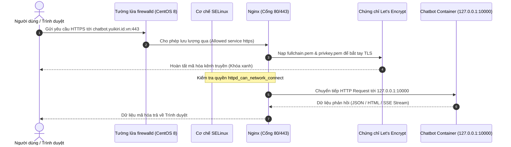

# Ánh xạ Tên miền và Thiết lập Chứng chỉ SSL trên Nginx CentOS 8

## Essence
- **Định nghĩa 1 câu:** Nginx Reverse Proxy là tầng cổng vào (Ingress Gateway) nhận lưu lượng truy cập mạng từ cổng chuẩn HTTP (80) và HTTPS (443), thực hiện giải mã lớp bảo mật TLS/SSL bằng chứng chỉ số X.509, sau đó ánh xạ tên miền tới đúng ứng dụng nội bộ theo khối cấu hình định danh ảo (`server_name`).
- **Vấn đề kỹ thuật giải quyết:**
  1. *Ẩn giấu cổng nội bộ:* Người dùng không cần phải gõ cổng `:10000` trên trình duyệt để truy cập ứng dụng.
  2. *Hợp nhất nhiều dịch vụ trên 1 IP duy nhất:* Cho phép máy chủ chạy song song nhiều ứng dụng khác nhau trên các cổng nội bộ độc lập (ví dụ cổng 3000, 8080, 10000) nhưng đều dùng chung cổng chuẩn 80/443 thông qua cơ chế Server Name Indication (SNI).
  3. *Tách biệt trách nhiệm mã hóa (TLS Offloading):* Ứng dụng nghiệp vụ (ASP.NET Core/React) không cần phải tự đọc và nạp tệp chứng chỉ SSL phức tạp; toàn bộ gánh nặng bắt tay mã hóa được Nginx xử lý ở hiệu năng C thuần tối ưu.
- **Mô hình trực giác (Mental Model):** Nginx như một lễ tân tòa nhà đa năng. Khi khách đến cửa trước (cổng 443), lễ tân kiểm tra thẻ căn cước (chứng chỉ SSL), hỏi tên phòng ban muốn gặp (tên miền `chatbot.yuikiri.id.vn`), và dẫn khách vào đúng phòng làm việc nội bộ (cổng 10000) ở tầng hầm.

## Mechanics
- **Quy trình tương tác:**


- **Quy trình Cài đặt & Cấu hình Thực tế trên CentOS 8:**

  ### Bước 1: Cài đặt Nginx và Mở cổng Tường lửa
  ```bash
  # Cài đặt Nginx từ kho phần mềm AppStream chuẩn của CentOS 8
  sudo dnf install -y nginx

  # Bật dịch vụ Nginx tự khởi động cùng hệ điều hành
  sudo systemctl enable --now nginx

  # Mở cổng dịch vụ HTTP (80) và HTTPS (443) trên firewalld
  sudo firewall-cmd --permanent --add-service=http
  sudo firewall-cmd --permanent --add-service=https
  sudo firewall-cmd --reload
  ```

  ### Bước 2: Cấp phép SELinux cho Nginx (Bước Quyết Định trên RHEL/CentOS)
  Trên CentOS 8, SELinux được bật ở chế độ `Enforcing`. Theo mặc định, SELinux cấm tiến trình Nginx thực hiện kết nối mạng ra các cổng nội bộ, dẫn tới lỗi **`502 Bad Gateway`** kèm log lỗi `(13: Permission denied) while connecting to upstream`.
  Để khắc phục, bắt buộc phải bật cờ mạng cho Nginx:
  ```bash
  sudo setsebool -P httpd_can_network_connect 1
  ```

  ### Bước 3: Soạn thảo khối Virtual Host cho Subdomain
  Tạo tệp cấu hình `/etc/nginx/conf.d/chatbot.conf`:
  ```nginx
  server {
      listen 80;
      server_name chatbot.yuikiri.id.vn;

      # Tăng giới hạn upload tài liệu y văn lên 50MB
      client_max_body_size 50M;

      location / {
          proxy_pass http://127.0.0.1:10000;
          proxy_http_version 1.1;

          # Hỗ trợ truyền dữ liệu thời gian thực (WebSocket & Server-Sent Events - SSE)
          proxy_set_header Upgrade $http_upgrade;
          proxy_set_header Connection 'upgrade';

          # Bảo toàn thông tin định danh người dùng gốc
          proxy_set_header Host $host;
          proxy_set_header X-Real-IP $remote_addr;
          proxy_set_header X-Forwarded-For $proxy_add_x_forwarded_for;
          proxy_set_header X-Forwarded-Proto $scheme;

          # Tắt bộ đệm trung gian khi AI đang stream câu trả lời
          proxy_buffering off;
          proxy_read_timeout 300s;
      }
  }
  ```
  Kiểm tra cú pháp và áp dụng:
  ```bash
  sudo nginx -t
  sudo systemctl reload nginx
  ```

  ### Bước 4: Tự động Cấp phát Chứng chỉ SSL qua Certbot (Let's Encrypt)
  Certbot sử dụng giao thức ACME tự động xác thực quyền sở hữu tên miền qua thử thách HTTP-01 và cấu hình tự động vào Nginx:
  ```bash
  # Cài đặt kho EPEL và gói Certbot Nginx
  sudo dnf install -y epel-release
  sudo dnf install -y certbot python3-certbot-nginx

  # Chạy script cấp phát chứng chỉ
  sudo certbot --nginx -d chatbot.yuikiri.id.vn
  ```
  Sau khi chạy, Certbot tự động cập nhật tệp `chatbot.conf`, cấu hình lắng nghe cổng `443 ssl` và tạo luật chuyển hướng HTTP sang HTTPS vĩnh viễn (`301 Moved Permanently`).

  ### Bước 5: Cấu hình Ủy quyền Đăng nhập trên Google Firebase
  Để các tính năng đăng nhập Google Authentication và Email Link hoạt động hợp lệ khi chạy trên tên miền mới:
  1. Truy cập [Firebase Console](https://console.firebase.google.com/) $\rightarrow$ Chọn dự án `chatbot-v1-c7709`.
  2. Vào mục **Build** $\rightarrow$ **Authentication** $\rightarrow$ Chuyển sang tab **Settings**.
  3. Cuộn xuống phần **Authorized domains** (Miền được ủy quyền).
  4. Bấm **Add domain** và nhập chính xác:
     ```text
     chatbot.yuikiri.id.vn
     ```
  5. Bấm **Save**. Việc này cấp quyền cho OAuth SDK chấp nhận các phiên chuyển hướng đăng nhập phát sinh từ tên miền này.

## Contract
- **Cấu trúc Tệp Chứng chỉ X.509:**
  - `/etc/letsencrypt/live/chatbot.yuikiri.id.vn/fullchain.pem`: Chứa chứng chỉ của tên miền và chứng chỉ trung gian (Intermediate CA Chain) để gửi cho trình duyệt xác thực.
  - `/etc/letsencrypt/live/chatbot.yuikiri.id.vn/privkey.pem`: Khóa bí mật (Private Key) được lưu giữ nghiêm ngặt trên VPS, quyền hạn `600`, không bao giờ được chia sẻ ra ngoài.
- **Cơ chế Tự động Gia hạn Chứng chỉ (Renewal Contract):**
  Chứng chỉ Let's Encrypt có hiệu lực 90 ngày. Gói cài đặt Certbot trên CentOS 8 tự động kích hoạt một bộ đếm thời gian hệ thống (Systemd Timer):
  ```bash
  # Kiểm tra trạng thái bộ hẹn giờ tự động gia hạn
  sudo systemctl status certbot-renew.timer

  # Chạy thử nghiệm quy trình gia hạn (Dry-run)
  sudo certbot renew --dry-run
  ```

## Trade-offs
- **Lợi ích kiến trúc (Architectural Gains):**
  - *Hiệu năng:* Nginx được tối ưu hóa ở mức C/Linux Kernel với mô hình hướng sự kiện (Epoll), xử lý hàng chục nghìn kết nối đồng thời với mức tiêu thụ RAM cực thấp (< 50MB).
  - *Bảo mật:* Cô lập hoàn toàn container backend trong mạng nội bộ của máy chủ (`127.0.0.1`), chỉ để lộ cổng 80/443 ra ngoài Internet.
  - *Thân thiện với người dùng:* Đường dẫn chuẩn `https://chatbot.yuikiri.id.vn` không kèm số cổng rườm rà.
- **Cái giá vận hành (The Cost & Overhead):**
  - Cần duy trì cấu hình SELinux và kiểm tra log Nginx (`/var/log/nginx/error.log`) khi có sự cố mạng nội bộ.
  - Nếu sử dụng song song với Cloudflare Proxy, cần đồng bộ thiết lập chứng chỉ để tránh xung đột chuyển hướng.
- **Cảnh báo Anti-Pattern:**
  - *Quên cấu hình WebSocket / SSE headers (`Upgrade`, `Connection`):* Làm ứng dụng Chatbot AI bị ngắt kết nối đột ngột hoặc mất hiệu ứng gõ chữ từng token (streaming response).
  - *Quên cờ `proxy_buffering off`:* Khiến Nginx gom toàn bộ nội dung câu trả lời của AI vào bộ đệm rồi mới gửi một lần, làm mất hoàn toàn trải nghiệm phản hồi nhanh của người dùng.
  - *Mở cổng ứng dụng (`10000`) trực tiếp ra Internet:* Bỏ qua tầng kiểm soát của Nginx, tạo lỗ hổng cho kẻ xấu tấn công trực tiếp vào ASP.NET Core backend.

## Relations
- Tri thức liên quan:
  - [[Cloudflare-DNS-and-Edge-Proxy-Integration]] — Định tuyến DNS và lá chắn bảo vệ trước khi truy cập chạm vào Nginx.
  - [[CI-CD-Deployment-Pipeline]] — Quy trình cập nhật ứng dụng tự động phía sau Nginx.
