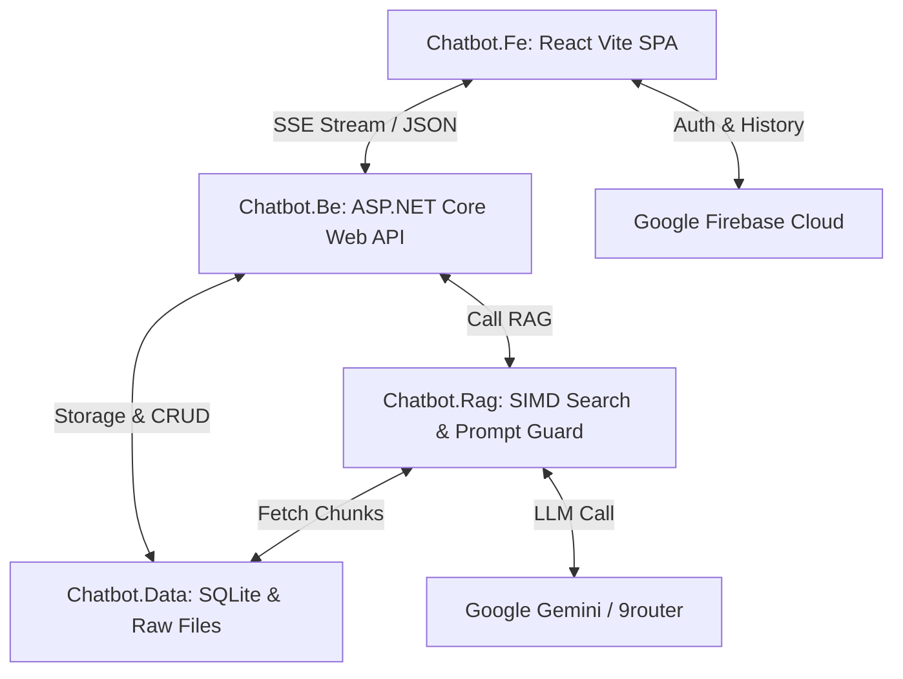

# Plan 00: Điều Phối Tổng Thể Chatbot Tư Vấn Thuốc Cho Con Bú (Chatbot_v1)

## 1. Mục Tiêu Hệ Thống
Xây dựng giải pháp phần mềm trợ lý ảo y tế chuyên sâu hỗ trợ tra cứu tính an toàn của thuốc cho phụ nữ đang nuôi con bằng sữa mẹ.
- **Backend:** .NET 8 Web API (`src/Chatbot.Be`), lõi RAG (`src/Chatbot.Rag`), quản trị dữ liệu (`src/Chatbot.Data`).
- **Frontend:** React + TypeScript + Vite + Tailwind CSS (`src/Chatbot.Fe`).
- **Tri thức y tế:** Khép kín (Closed-domain), chỉ có Admin mới có quyền nạp và xóa tài liệu. Hỗ trợ bấm vào trích dẫn để bôi đậm (highlight) đúng đoạn y văn gốc.
- **Mô hình AI:** Mặc định chạy Google Gemini 1.5 Flash (miễn phí), hỗ trợ chuyển đổi linh hoạt sang 9router hoặc OpenAI-compatible qua biến môi trường.
- **Đăng nhập & Lịch sử:** Tích hợp Firebase Auth và Cloud Firestore để lại placeholder rõ ràng.

## 2. Danh Sách Sub-Plans Liên Kết
1. [Plan 01: Scaffolding Solution & Cấu Trúc Dự Án](plan-01-scaffolding-and-structure.md)
2. [Plan 02: Quản Lý Dữ Liệu & Kho Y Văn Admin (Chatbot.Data)](plan-02-data-and-admin-management.md)
3. [Plan 03: Lõi RAG & AI Provider Abstraction (Chatbot.Rag)](plan-03-rag-and-llm-engine.md)
4. [Plan 04: Backend API & Streaming SSE (Chatbot.Be)](plan-04-backend-api.md)
5. [Plan 05: Frontend React ChatGPT-Style & Citation Highlight (Chatbot.Fe)](plan-05-frontend-react.md)

## 3. Sơ Đồ Kiến Trúc

